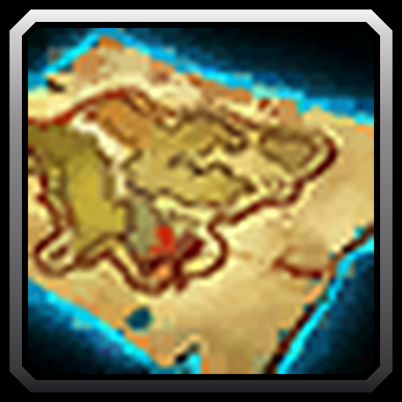

# Simple Map

A WoW Forever addon that lifts the fog of war from the world map, so every area shows even before you explore it, and lets you move and resize the map. The full-screen map no longer blacks out the game, so the world stays in view around it.

## Features

- Every zone shows in full, including the areas you have not explored yet. Your exploration progress stays as it is.
- Move the Map & Quest Log and the full-screen map by dragging their title bars. Each keeps its own place.
- Resize the full-screen map from its bottom-right corner. Zooming in and out keeps working at any size.
- The full-screen map shows the game world around it instead of a black screen, and clicks reach the world.
- Nothing to set up.

## Usage

1. Open the map with M.
2. Drag its title bar to move it.
3. On the full-screen map, drag the bottom-right corner to resize it.
4. Scroll over the map to zoom in on any area.

Type /sm reset to put the map back in its usual place and size.
